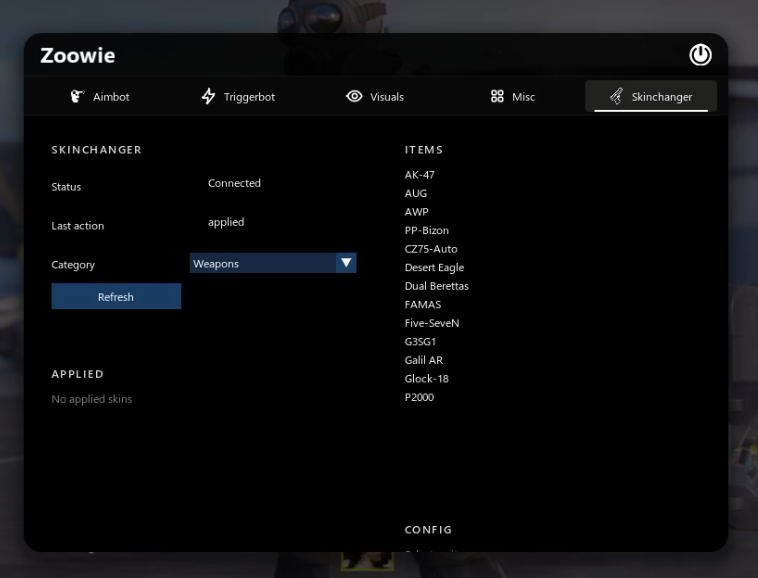

# Zoowie Internal

Internal CS2 skinchanger DLL.



## Build

```bat
cmake -S . -B build/release -G "Visual Studio 17 2022" -A x64
cmake --build build/release --target openchanger --config Release
```

Output: `build/release/zoowie_internal.dll`

## Config

`Default.cfg` included as a baseline config.
